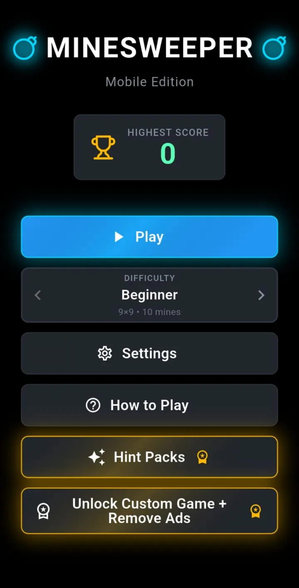
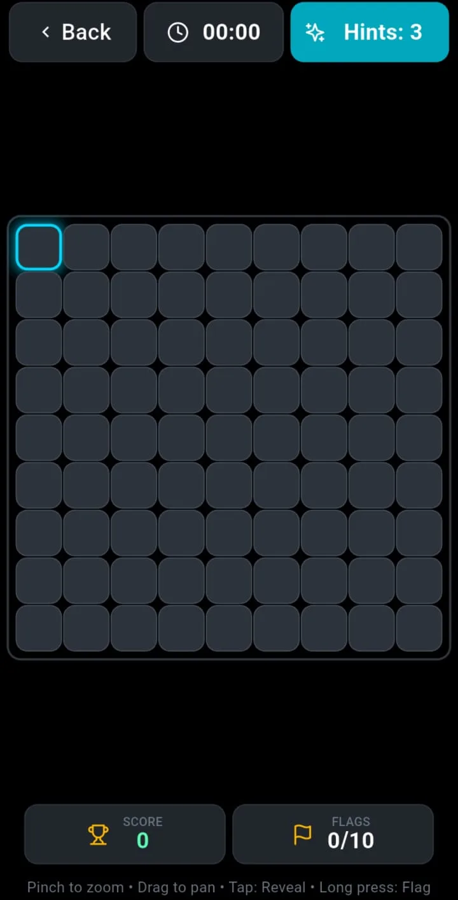
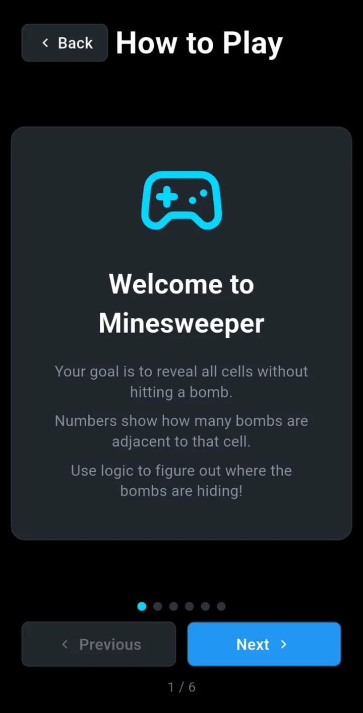
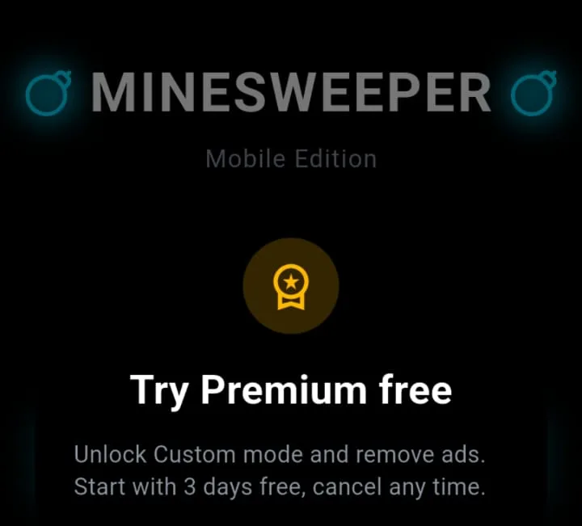
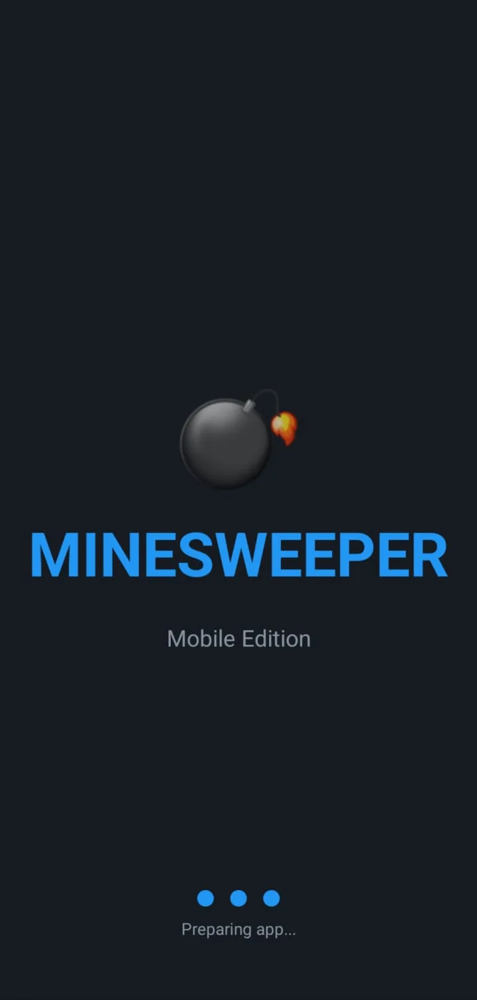
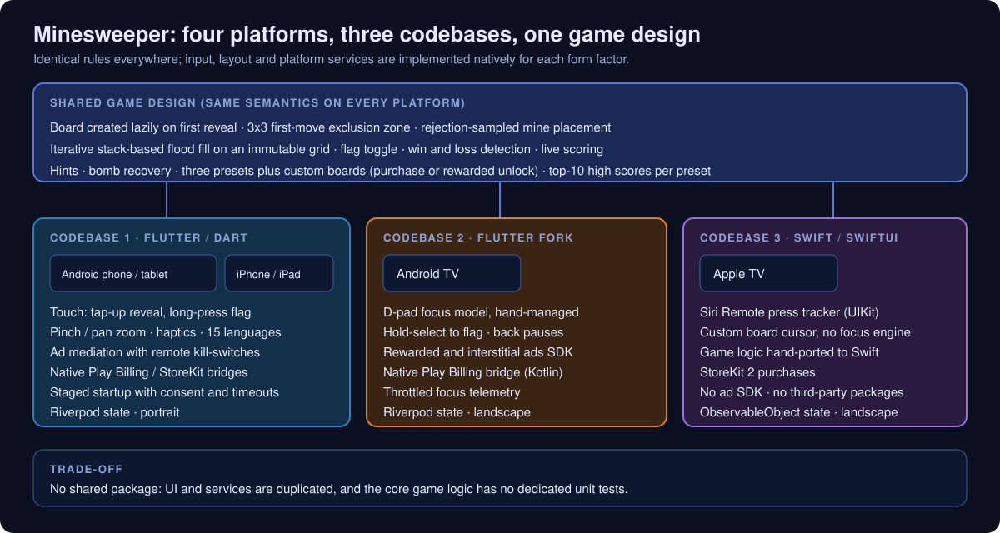
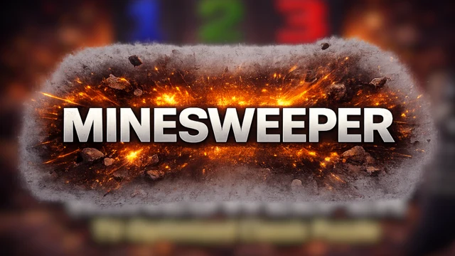
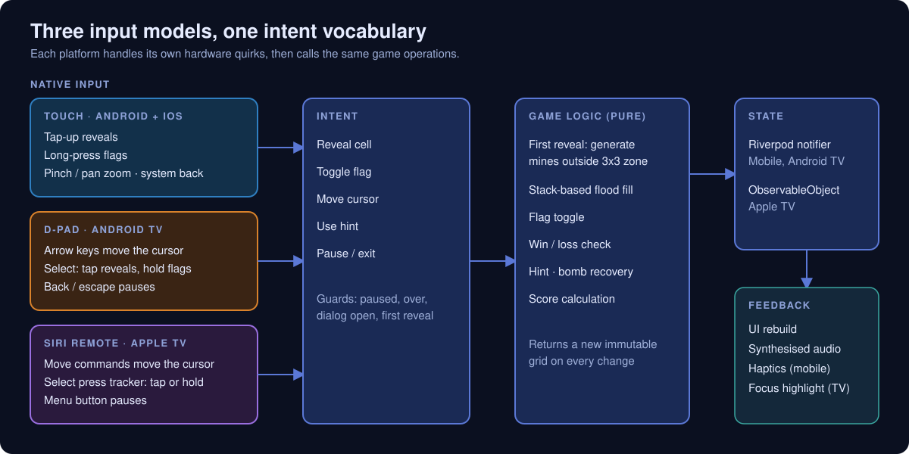
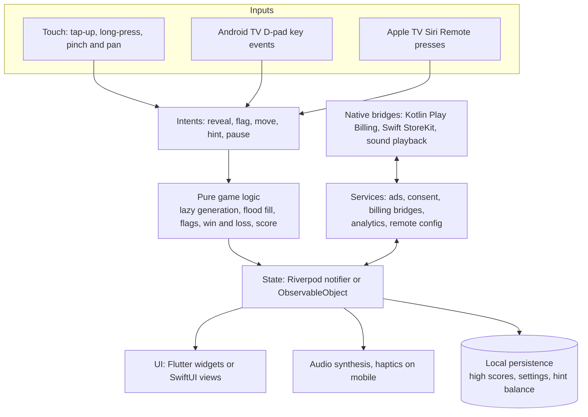

# Minesweeper

**A classic Minesweeper puzzle engineered for four platforms: one Flutter app for Android and iOS, a separate Flutter app for Android TV driven by a D-pad, and a native SwiftUI app for Apple TV driven by the Siri Remote.**

**Android phone and tablet · iOS · Android TV · Apple TV** 
Flutter · Dart · Kotlin · Swift · SwiftUI · Firebase · Play Billing · StoreKit

<table>
  <tr>
    <td></td>
    <td></td>
  </tr>
</table>
Real screenshots from the Android build, cropped to the app content (system status bar and ad-placeholder strips removed), captured with sample data, metadata removed. No TV screenshots are published in this repository.

---

## Get the App

  
  

## Product at a Glance

| | |
|---|---|
| **What it is** | Classic Minesweeper: reveal every safe cell using adjacent-mine counts and flags |
| **Boards** | Three presets (Beginner, Intermediate, Expert) plus custom boards, unlocked by purchase or, on the ad-supported apps, for one game through a rewarded ad |
| **Game systems** | Flagging, hints, a bomb-recovery continue mechanic, live scoring, top-10 high scores per preset |
| **Platforms** | Android phone and tablet, iOS, Android TV, Apple TV |
| **Codebases** | Three: a Flutter app (Android and iOS), a Flutter fork for Android TV, a native Swift/SwiftUI app for Apple TV |
| **Input** | Touch with pinch/pan zoom, D-pad key events, Siri Remote press tracking |
| **Platform services** | Native Play Billing and StoreKit bridges, remote ad kill-switches and a consent flow (mobile), analytics and crash reporting (both Flutter apps) |
| **Localization** | 15 languages on the mobile app; the TV apps are English only |
| **Code size** | About 30,000 lines of Dart in the mobile app, 15,700 in the Android TV app (`lib/`, excluding generated localization) and 4,400 lines of Swift in the Apple TV app |

## Showcase

<table>
  <tr>
    <td align="center"> <b>How to Play</b> Six-page in-app tutorial</td>
    <td align="center"> <b>Premium dialog</b> Heading and description</td>
    <td align="center"> <b>Splash</b> Shown while startup stages complete</td>
  </tr>
</table>

## Four Platforms, Three Codebases

The headline engineering decision is how one game design is delivered to four very different devices without pretending they share an input model. A phone is touched, an Android TV is driven by a D-pad, and an Apple TV by a Siri Remote that is part trackpad, part button. Game rules are identical everywhere; input, layout and services are native to each.

  

<table>
  <tr>
    <td width="50%" align="center"> <b>Android TV</b>: launcher banner artwork shipped with the TV app (artwork, not a screenshot)</td>
    <td width="50%" align="center"> <b>Apple TV</b>: back layer of the layered app icon (artwork, not a screenshot)</td>
  </tr>
</table>

Android TV and Apple TV are represented here by artwork and original diagrams only. There are no TV gameplay screenshots in this repository.

| | Android and iOS | Android TV | Apple TV |
|---|---|---|---|
| **Codebase** | One Flutter app | Separate Flutter fork | Native Swift / SwiftUI |
| **Primary input** | Touch: tap-up reveal, long-press flag, pinch/pan zoom | D-pad keys: select reveals, hold-select flags | Siri Remote: select press tracker, move commands |
| **Focus model** | Direct touch targets | Hand-managed cursor over a keyboard-style key handler | Custom cursor that bypasses the platform focus engine |
| **Back / exit** | Android system back opens the pause menu | Back key pauses with exit confirmation | Menu button pauses with exit confirmation |
| **Orientation** | Portrait | Landscape | Landscape |
| **Ads** | Mediation SDK, remote kill-switches | Ads SDK, rewarded and interstitial | No ad SDK in the app |
| **Purchases** | Play Billing / StoreKit via native bridges | Play Billing via native bridge | StoreKit 2 |
| **Haptics** | Yes, user toggle | No | No |
| **Localization** | 15 languages | English | English |
| **Telemetry** | Analytics, crash reporting, performance traces | Analytics, crash reporting | None |

Full comparison: [docs/MOBILE_VS_TV.md](docs/MOBILE_VS_TV.md).

## Engineering Highlights

### A fair, lazily generated board
- **Problem:** the first tap in Minesweeper must never lose, and a board generated at game start can be inspected or solved before the first move.
- **Approach:** the board stays empty and mine-free until the first reveal. Mines are then placed by rejection sampling over every cell outside a 3x3 exclusion zone around the tapped cell. Custom boards cap the mine count so the exclusion zone always leaves room.
- **Outcome:** the first reveal is always a zero-cell that cascades open. The same algorithm runs in Dart (two apps) and Swift, where the port adds an attempt cap as a safety net.

### Flood fill that cannot overflow the stack
- **Problem:** a cascading reveal on a board of a few hundred cells must be safe, predictable and easy to reason about.
- **Approach:** an iterative, stack-based fill with a visited set, living in a pure logic class that returns a fresh copy of the grid (cells are immutable value objects) plus the count of newly revealed cells. Flags block expansion.
- **Outcome:** identical behaviour across three apps, with no recursion and no hidden mutation between the rules and the UI.

### Three input models, one intent vocabulary
- **Problem:** the same actions (reveal, flag, move, pause) must feel native on touch, a D-pad and a Siri Remote.
- **Approach:** touch reveals on tap-up, not tap-down, so a long-press or pan cannot detonate a mine; Android TV runs a hand-managed focus cursor with a hold timer; Apple TV uses a UIKit press tracker feeding SwiftUI, so the board does not depend on the focus engine.
- **Outcome:** reveal, flag and pause map the same way on every platform. See the [input pipeline](docs/ARCHITECTURE.md#input-pipeline).

  

### Bomb recovery without corrupting game state
- **Problem:** letting a player continue after a mine (through a rewarded flow) must not break scoring, flag counts or win detection.
- **Approach:** a loss stops the timer but keeps mines hidden. Recovery converts the exploded cell into a flag, restarts the timer, applies a score penalty, is capped per game and guarded against being granted twice.
- **Outcome:** the win condition stays valid because flagged cells count as unrevealed. Recovery is wired to the reward flow on Mobile and Android TV.

### Ads that fail closed
- **Problem:** ad placements need a remote off switch without an app release, and a stalled network must never look like a launch failure.
- **Approach:** per-placement and global kill-switches read from a single remote configuration document, with no ad until a confirmed fetch says yes. Startup is staged (storage and Firebase init, native entitlement sync, consent, remote config, ad load), each stage bounded by a timeout.
- **Outcome:** ads default to off, premium users skip the ad path entirely, and every stage is measured with performance traces.

### More
| Area | What was built |
|---|---|
| **Billing** | Native Kotlin (Play Billing) and Swift (StoreKit) managers behind platform channels on the Flutter apps; StoreKit 2 directly in the Apple TV app; restore and consumable handling |
| **Audio** | No audio asset files: tones are synthesised at startup and played through SoundPool, AVAudioPlayer or an AVAudioEngine node |
| **Haptics** | Every game sound maps to a haptic pattern, behind a user toggle (mobile only) |
| **Lifecycle** | Pause on backgrounding with a latch that fixes a stranded-pause event sequence |
| **Telemetry** | In-memory aggregation of touch events into one summary per game; throttled TV focus events; payload sanitiser and a pre-init queue |
| **Localization** | 15 languages on mobile via generated localizations |
| **Tests** | Mobile: widget and gesture tests, lifecycle, ads, analytics, billing parsing. Android TV: analytics. Apple TV: none. No dedicated unit tests for core game logic |

Details and trade-offs: [docs/ENGINEERING_CHALLENGES.md](docs/ENGINEERING_CHALLENGES.md).

## Architecture

More diagrams (per-platform layers, startup, billing, shared versus platform-specific code): [docs/ARCHITECTURE.md](docs/ARCHITECTURE.md).

## Honest Trade-offs

- **Duplication.** The two Flutter apps share a lineage but not a package: 59 source paths exist in both, 10 are byte-identical (including the game-rules class and the cell and game-state models) and 49 have diverged. The Apple TV logic is a hand port. A fix to shared rules must be applied up to three times.
- **Test depth.** There are widget tests for gestures and lifecycle, plus ads, analytics and billing-parsing tests on mobile, but no dedicated unit tests for board generation, flood fill or scoring, and no test target in the Apple TV app.
- **Client-side balances.** Hint balances and entitlement flags are stored on the device. Server-side entitlement verification would be a natural next step.
- **Not implemented:** game-state restore after the app is killed, accounts or cloud sync, achievements, chording, and accessibility semantics for the board.

## Technology Stack

| Layer | Technology |
|---|---|
| Mobile and Android TV UI | Flutter / Dart 3 |
| Apple TV UI | Swift, SwiftUI, UIKit interop for the remote |
| UI state | Riverpod (Flutter); `ObservableObject` and Combine (Apple TV) |
| Navigation | `go_router` (Flutter); a small screen-stack manager (Apple TV) |
| Local storage | Hive and shared preferences (Flutter); `UserDefaults` (Apple TV) |
| Backend services | Firebase Analytics, Crashlytics, Performance, Messaging and remote configuration on mobile; Analytics and Crashlytics on Android TV |
| Billing | Kotlin Play Billing; Swift StoreKit (iOS bridge) and StoreKit 2 (Apple TV) |
| Ads | Mediation SDK (mobile), ads SDK (Android TV), none in the Apple TV app |
| Audio | Procedurally synthesised PCM/WAV, platform audio players |
| Tooling | R8, baseline profile and macrobenchmark modules (Android TV) |

## Documentation

| Read | For |
|---|---|
| [Product overview](docs/PRODUCT_OVERVIEW.md) | What the game does and how each platform plays |
| [Technical case study](docs/TECHNICAL_CASE_STUDY.md) | Game logic, input, services and platform engineering end to end |
| [Architecture](docs/ARCHITECTURE.md) | Layers, data flow and component diagrams |
| [Mobile vs TV](docs/MOBILE_VS_TV.md) | Four-platform comparison: input, focus, performance, reuse |
| [Engineering challenges](docs/ENGINEERING_CHALLENGES.md) | Problem, approach, outcome and trade-offs |
| [Privacy and source](docs/PRIVACY_AND_SOURCE.md) | What is and is not published |

## Source Code

This repository is a portfolio showcase for a production application. Production source code is maintained privately. See [RIGHTS.md](RIGHTS.md) for usage terms.
