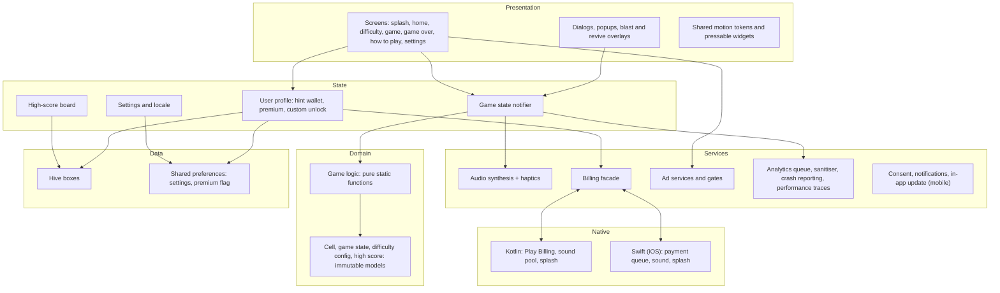
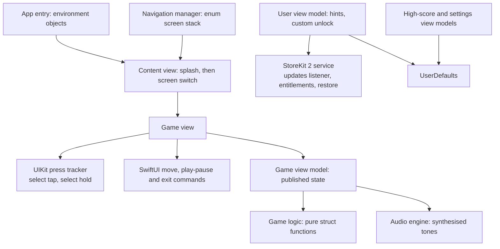
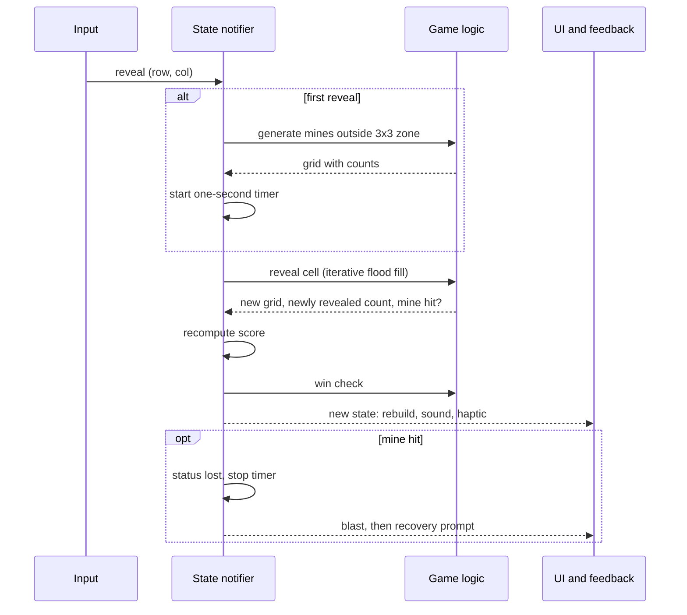
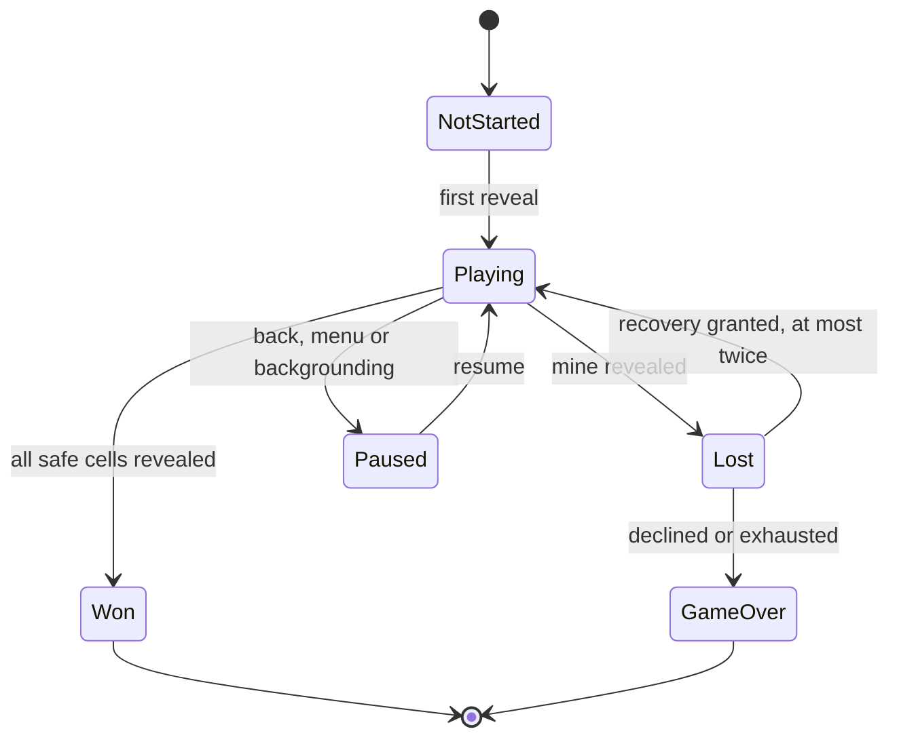
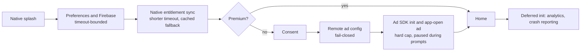
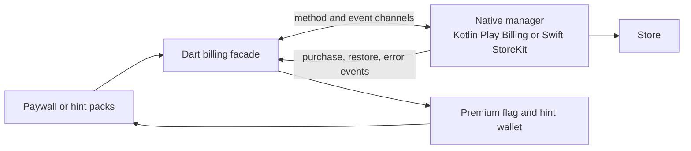

# Architecture

Diagram labels are conceptual and do not correspond to production identifiers.

## Platform and codebase map

Four platforms are built from three codebases that implement one game design.

  

## Flutter apps: layers

The mobile app and the Android TV app follow the same layering. The mobile app has additional services (consent, notifications, update, localization, ad mediation); the TV app has a smaller set plus focus telemetry.

State is held in Riverpod providers: a game-state notifier owns the grid, status, timer and counters; separate providers own the user profile, high scores and settings. The notifier calls the pure logic layer and replaces its state with the result, so rebuilds are driven by immutable value changes.

## Apple TV app: layers

The native app has no third-party dependencies and no analytics, crash or ad SDKs.

The SwiftUI side uses `ObservableObject` view models and environment injection. The press tracker and the move commands are the only input path to the board.

## Input pipeline

  

Each platform converts hardware input into the same few intents, each guarded by state: not while paused, not after the game is over, not while a dialog is open, and not a flag before the first reveal.

## One reveal, end to end

## Bomb recovery state

On recovery the exploded mine is converted to a flag, so the hidden-plus-flagged count still equals the mine total and the win condition stays valid. The reward gate resolves once per request and the recovery is re-checked against the per-game limit. On Apple TV the logic transition exists but the post-loss dialog offers restart or exit.

## Startup (mobile)

## Billing path

The Apple TV app skips the bridge and uses StoreKit 2 from Swift directly. The Flutter apps and the Apple TV app handle purchases independently; entitlements are not shared between them.

## Shared versus platform-specific

| Concern | Shared across platforms | Platform-specific |
|---|---|---|
| Rules | Generation, flood fill, flags, win and loss, score, hints, recovery (identical Dart in two apps, hand-ported Swift) | None |
| Models | Cell, game state, high-score and profile models (byte-identical in the two Flutter apps) | Swift equivalents |
| Input | Intent vocabulary | Gesture detectors, key handling, UIKit press tracker |
| Layout | Visual language and colours | Portrait mobile layout, landscape TV layouts, cell sizing |
| Services | Concepts: audio synthesis, analytics sanitising | Ads vendor, consent, notifications, update, billing surface, telemetry |
| Persistence | Data shape of high scores | Hive and shared preferences, or `UserDefaults` |
